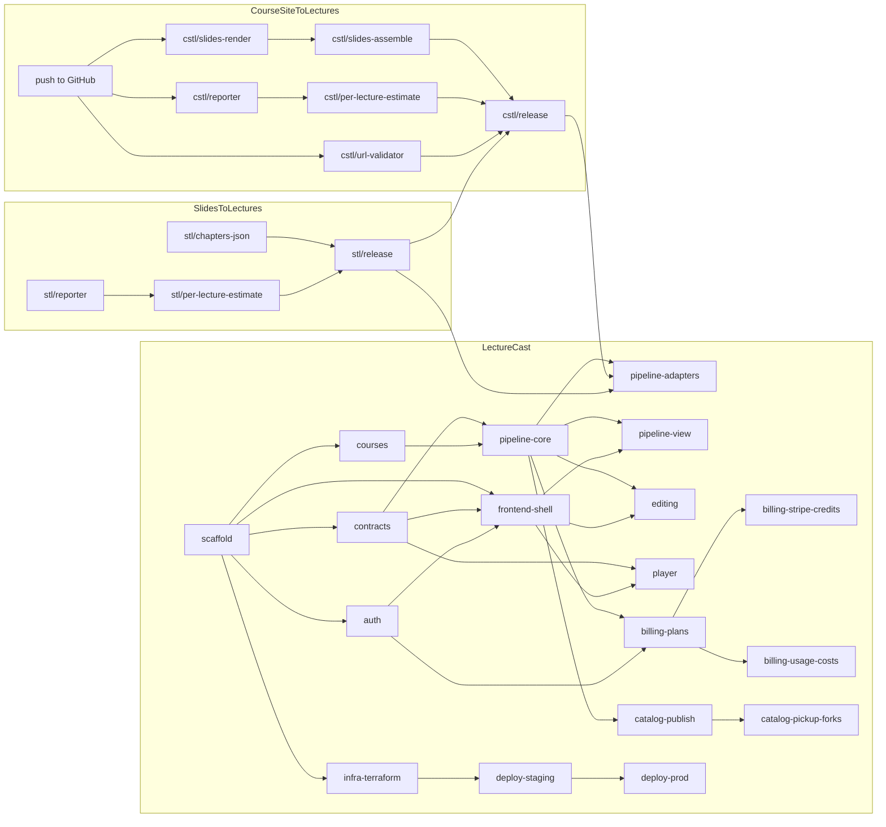

# Workstreams: parallel branches and pull requests

Part of the [LectureCast plan](../../PLAN.md). This doc breaks the milestones into branches that
can be worked on at the same time, each landing as one PR. The milestones still define what is
shippable; this defines the order the work can happen in.

## Principles

- **Contracts first.** Formats that two tracks share are fixed early, in small PRs, so both sides
  can build against fixtures: the reporter protocol, `chapters.json`, `player.json`, the stage
  function signature, and the OpenAPI schema (generated by drf-spectacular, with TypeScript types
  generated for the frontend).
- **Fakes, not waiting.** LectureCast doesn't wait for Phase 0. The pipeline calls stages through
  an adapter, and fake stage functions write fixture outputs until the real libraries are
  released.
- **One app per branch.** Each backend branch owns its Django app and its migrations, which keeps
  parallel branches from conflicting. Model PRs land early, before the views built on them.
- **Small PRs into `main`.** Branches start from `main` and rebase on it. A PR that depends on an
  unmerged one says so, and is based on that branch until it merges.
- **One worktree per branch** when several sessions work in parallel.

## Branch graph

Arrows mean "needs to merge first". Branches in the same column can run at the same time.

## Branches

### Library repos (Phase 0, [phase0-libraries.md](phase0-libraries.md))

| Branch | Repo | Contents | Needs |
|---|---|---|---|
| — | CSTL | Create `ExNumberless/CourseSiteToLectures` and push `main`. | |
| `stl/reporter` | STL | Reporter protocol (`step`, `log`, `usage`) in `lecture.run` and `tts.run`, with a printing default. | |
| `stl/chapters-json` | STL | Write `<name>.chapters.json` next to each MP3. | |
| `stl/per-lecture-estimate` | STL | One-lecture calls checked for file isolation; `estimate` for `transcript` and `tts`. | `stl/reporter` |
| `stl/release` | STL | Version bump and PyPI publish. | all STL |
| `cstl/reporter` | CSTL | The same protocol (structural, so no import from STL) in `materials`, `vision` and `fetch`. | push |
| `cstl/url-validator` | CSTL | Injectable URL validator in the `Web` client. | push |
| `cstl/slides-render` | CSTL | `slides.render` and the `player.json` schema, with a fixture course. | push |
| `cstl/slides-assemble` | CSTL | `slides.assemble`, built against a fixture `chapters.json`; the `slides` CLI command. | `cstl/slides-render` |
| `cstl/per-lecture-estimate` | CSTL | One-lecture `materials` checked for isolation; `estimate` for `materials` and `render`. | `cstl/reporter` |
| `cstl/release` | CSTL | Drop the git `[tool.uv.sources]` entry, pin STL, publish. | all CSTL, `stl/release` |

The two library tracks run in parallel from the start. Only the CSTL release waits for STL.

### LectureCast, wave 1

| Branch | Contents | Needs | Status |
|---|---|---|---|
| `scaffold` | `mise.toml`, empty Django project and apps, Vite app, docker-compose (Postgres, Redis, RustFS for S3, Mailpit), CI running lint and tests. | | Merged: [PR #29](https://github.com/ExNumberless/LectureCast/pull/29) |

Everything else branches from `scaffold`, so it should be small and land first.

### LectureCast, wave 2 (all in parallel)

| Branch | Contents | Needs | Status |
|---|---|---|---|
| `contracts` | Stage function signature and adapter interface; reporter protocol on the backend side; `player.json` and `chapters.json` fixtures copied from the library PRs; drf-spectacular and TypeScript type generation. | `scaffold` | Merged: [PR #35](https://github.com/ExNumberless/LectureCast/pull/35) |
| `auth` | Custom `User`, allauth headless with email and Google, `__Host-` session and CSRF cookies, sign-in and sign-up pages. Milestone 2. | `scaffold` | Merged: [PR #34](https://github.com/ExNumberless/LectureCast/pull/34); local session and sign-out flow in [PR #36](https://github.com/ExNumberless/LectureCast/pull/36) |
| `courses` | `Course`, `Lecture`, `Slide`; provider registry with settings schemas; courses API and presigned ZIP uploads. | `scaffold` | In review: [PR #39](https://github.com/ExNumberless/LectureCast/pull/39) |
| `frontend-shell` | Routing, layout, TanStack Query client on the generated types, shadcn/ui setup, My courses and New course pages. | `scaffold`, `contracts`, `auth` | Merged: [PR #37](https://github.com/ExNumberless/LectureCast/pull/37) |
| `infra-terraform` | Terraform modules, the `org` environment (accounts, service control policies, Identity Center, CloudTrail, the `lecturecast.` and `staging.lecturecast.` hosted zones and their delegation, after auditing the existing management account) and the staging environment, with the controls in [security.md](security.md): three subnet tiers, per-service task roles, the KMS key, TLS everywhere. `validate`, Checkov, gitleaks and `plan` in CI, and Dependabot. No account IDs, bucket names or `tfvars` committed: values come from GitHub environment variables and `.env`. Doesn't touch app code. | `scaffold` | Ready |

### LectureCast, wave 3

| Branch | Contents | Needs |
|---|---|---|
| `deploy-staging` | Docker images, the deploy workflow through the OIDC roles (account IDs and role ARNs from the `staging` GitHub environment's variables), the staging environment, weekly image rebuilds, the ZAP baseline scan, the `rotate-secrets` workflow (tested once) and a smoke test, so staging is up for M3. | `infra-terraform` |
| `pipeline-core` | Stage registry, `StageNode`/`PipelineRun`/`StageRun`, the scheduler, lecture selection, staleness, workspace sync with the shared course cache, the pipeline API; fake stages. Milestone 3's backend. | `contracts`, `courses` |
| `player` | Player page against fixture `player.json`: seeking, auto-advance, controls, KaTeX and code slides. Milestone 4's frontend. | `contracts`, `frontend-shell` |

### LectureCast, wave 4 (all in parallel)

| Branch | Contents | Needs |
|---|---|---|
| `pipeline-view` | The pipeline view: lecture × stage grid, node detail, run dialog. | `pipeline-core`, `frontend-shell` |
| `editing` | Per-section editing of materials and transcripts, keeping the generated original; diff view; staleness on save. Part of milestone 3. | `pipeline-core`, `frontend-shell` |
| `pipeline-adapters` | Real CSTL/STL calls behind the adapter, the `tts` and `fetch` queues, `worker-fetch`'s settings module (no `SECRET_KEY`) and `fetch` Postgres role, JSON-only tasks that load their inputs by node ID, safety checks (SSRF, limits, zip checks). Completes milestones 3 and 4 with the two test courses on staging. | `pipeline-core`, both releases |
| `billing-plans` | `Plan`, capabilities, `HasCapability`, run-level capability checks, locked stages in the API. | `pipeline-core`, `auth` |
| `catalog-publish` | `Publication`, publication requests, first-publication moderation, license rules, freezing, reports and takedown, catalog page. | `pipeline-core` |
| `deploy-prod` | The prod environment, the domain, and promoting deploys from staging, with GuardDuty, WAF and backups copied to the management account. Milestone 6. | `deploy-staging` |

### LectureCast, wave 5

| Branch | Contents | Needs |
|---|---|---|
| `billing-stripe-credits` | dj-stripe with Stripe Tax, Checkout and portal, `CreditLedger`, monthly grants with rollover, top-ups, the trial grant, estimates, reservation and per-node charging, caps. | `billing-plans` |
| `billing-usage-costs` | `UsageEvent`, `PriceTable`, `InfraCost`, the cost dashboard, what-if tool and alerts. | `billing-plans` |
| `catalog-pickup-forks` | Claims, picking up, contributor credit, forks and variants, coverage grid and "ready for you". | `catalog-publish` (and `billing-stripe-credits` to charge pickups) |

## How many sessions at once

- From the start: two library tracks (STL and CSTL), plus `scaffold`.
- After `scaffold`: up to five LectureCast branches (wave 2) while the libraries continue.
- Waves 4 and 5 allow four or five at a time again.
